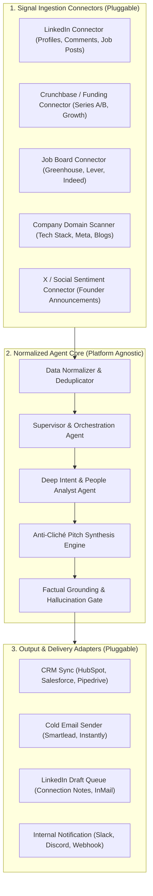

# Multi-Source B2B Lead Intelligence Agent Architecture

This document defines the agent roles, interaction protocols, and system guidelines for the **Multi-Platform Lead Intelligence Platform**.

---

## 1. Modular Plug-and-Play Architecture

The agent is decoupled using an **Adapter Pattern**: Ingestion sources and Delivery destinations are pluggable connectors, keeping the core reasoning and synthesis engine 100% platform-agnostic.



---

## 2. Core Agent Contracts

### Input Schema (`LeadSignalPayload`)
Every connector normalizes its raw signal into this standardized format:

```json
{
  "source_platform": "linkedin | crunchbase | website | job_board | twitter",
  "source_url": "https://linkedin.com/in/prospect or https://acme.com",
  "signal_type": "job_change | funding_round | hiring_surge | post_comment | product_launch",
  "signal_timestamp": "2026-11-05T12:00:00Z",
  "company": {
    "name": "Acme Technologies",
    "domain": "acme.com",
    "industry": "Healthcare SaaS",
    "size_range": "50-200"
  },
  "contact": {
    "first_name": "Sarah",
    "last_name": "Chen",
    "title": "VP of Operations",
    "profile_url": "https://linkedin.com/in/sarahchen"
  },
  "raw_context": "Recently posted: 'Struggling to scale our customer support lines as we open 10 new clinics this quarter.'"
}
```

---

## 3. Agent Roles & Specifications

### Agent 1: Ingestion Supervisor (`signal-router`)
* Normalizes inbound raw data from any connector.
* Validates company domain and deduplicates against the database to avoid re-pitching existing prospects.

### Agent 2: Signal Analyst (`intent-analyst`)
* Evaluates the trigger event (e.g., funding, hiring, or social post).
* Answers: *Why is this prospect experiencing operational friction today?*

### Agent 3: Multi-Channel Drafter (`channel-copywriter`)
Produces customized copy tailored to the intended delivery channel:
1. **LinkedIn Format**: Friendly, concise, under 250 characters.
2. **Cold Email Format**: 3-sentence framework (<85 words) with relevant case study hook.
3. **Internal Sales Brief**: 3-bullet summary for a human account executive.

### Agent 4: Quality & Anti-Hallucination Gate (`verifier`)
* Ensures that any fact mentioned in the pitch (e.g., "noticed you're opening 10 clinics") strictly traces back to the `raw_context` or scraped website text.
