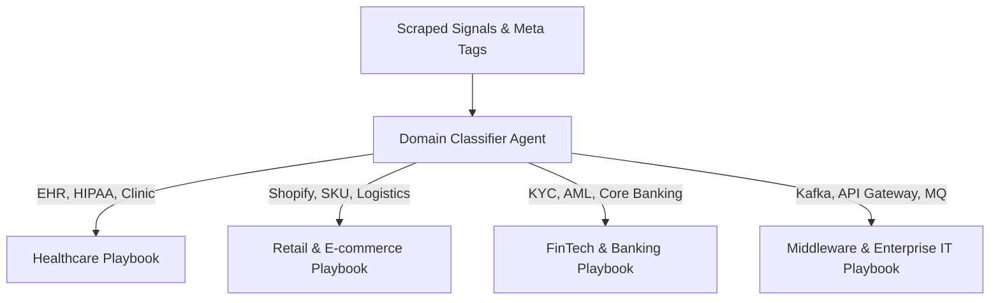

# Multi-Domain Adaptation Playbooks for B2B Lead Intelligence

This document details how the agent dynamically tunes its research filters, pain-point recognition, and pitch vocabulary across diverse commercial and technical sectors.

---

## 1. Dynamic Domain Classification & Vocabulary Matrix

When the agent analyzes a target company, it automatically classifies the domain into one of the specialized vertical playbooks:

---

## 2. Sector-by-Sector Breakdown & Sample Pitches

### Sector 1: Middleware & Enterprise Infrastructure (e.g., Kafka, MuleSoft, Cloud Migrations)
* **Target Personas**: VP of Engineering, Head of Infrastructure, Enterprise Architect.
* **Buying Triggers**: Scaling microservices, legacy mainframe decoupling, event-driven architecture bottlenecks.
* **Key Vocabulary**: Latency, throughput, message brokers, decoupled services, zero-downtime cutover.
* **Sample Agent Output**:
  > *"Saw Acme's recent blog post on migrating legacy payment pipelines to Kafka. Typically teams run into consumer lag spikes and schema registry versioning issues as event volume triples. We built an automated pipeline observability agent that flags message consumer bottlenecks before they cascade. Open to seeing the 2-minute architecture breakdown?"*

---

### Sector 2: Healthcare & Life Sciences
* **Target Personas**: Chief Medical Officer, VP of Clinical Operations, Practice Director.
* **Buying Triggers**: Regional site expansion, clinic acquisitions, EHR integration, staffing shortages.
* **Key Vocabulary**: Patient intake, hold times, HIPAA compliance, clinician burnout, EHR sync.
* **Sample Agent Output**:
  > *"Congrats on opening the 5 new surgical centers this quarter. Typically patient intake lines bottleneck during rapid regional expansions before front-desk staffing stabilizes. We built an autonomous triage agent that resolves appointment scheduling and intake hold times without adding headcount. Worth a brief look?"*

---

### Sector 3: Retail & E-Commerce
* **Target Personas**: Head of E-commerce, Chief Commercial Officer, Logistics Director.
* **Buying Triggers**: Seasonal peak traffic, multi-warehouse expansion, high return rates.
* **Key Vocabulary**: Conversion rate, cart abandonment, SKU velocity, 3PL fulfillment, chargebacks.
* **Sample Agent Output**:
  > *"Saw your catalog expansion into 2,000 new SKUs ahead of Q4. As product catalogs grow this fast, search zero-results and cart abandonment rates usually creep up by 15-20%. Our agent autonomously restructures product search tags to salvage high-intent searches. Open to a 2-minute visual breakdown?"*

---

### Sector 4: Banking, FinTech & Compliance
* **Target Personas**: Head of Compliance, VP of Risk, Chief Information Security Officer (CISO).
* **Buying Triggers**: New regulatory audits, expanding into cross-border payments, fraud surges.
* **Key Vocabulary**: KYC/AML friction, audit readiness, false-positive alerts, SOC2, PCI-DSS.
* **Sample Agent Output**:
  > *"Noticed Acme's expansion into cross-border merchant payouts. Typically onboarding friction and false-positive AML flags double during multi-jurisdiction rollouts. We built an automated compliance verification agent that speeds up merchant verification while remaining audit-ready. Open to seeing how cross-border teams handle this?"*

---

## 3. How the Engine Switches Playbooks Automatically

1. **Fingerprint Scrape**: The `WebDomainConnector` scans title, meta tags, and body text for sector keywords.
2. **Playbook Injection**: The system prompt dynamically loads the relevant vocabulary rules and banned buzzwords from `DOMAIN_ADAPTATION_PLAYBOOKS.md`.
3. **Tone Calibration**:
   * *Middleware/IT*: Highly technical, architectural, no fluff, metrics-focused.
   * *Healthcare*: Empathetic to staff burnout, patient-centric, compliance-conscious.
   * *FinTech*: Risk-mitigation, auditability, operational security.
