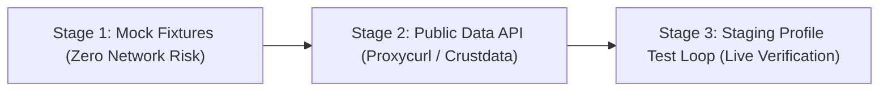

# LinkedIn Testing & Integration Guide

This guide details how to safely connect, test, and verify the Lead Intelligence Agent with LinkedIn before launching publicly.

---

## 1. The 3-Stage Testing Methodology



### Stage 1: Local Mock Fixture Testing (100% Risk-Free)
* Before touching the live web, test against static JSON snapshots of real LinkedIn profile exports.
* Verifies your parser extracts names, headlines, posts, and job history accurately without triggering any network requests or rate limits.

### Stage 2: Read-Only Profile Enrichment (API Method)
* Instead of running brittle browser scrapers that trigger captchas, use compliant B2B enrichment APIs (e.g., **Proxycurl**, **Crustdata**, or **RapidAPI LinkedIn Data API**).
* **Why**: They maintain pools of residential proxies and cache public data. You query a simple REST endpoint (`GET /api/v2/linkedin?url=...`), receiving clean JSON in 200 ms with **zero risk to your personal account**.

### Stage 3: Live Outreach Testing via a Staging Account
* **Rule #1**: **Never run raw test scripts from your primary personal LinkedIn account.**
* Create a dedicated secondary account ("Staging Account") with a custom domain email.
* Test with conservative limits:
  * Maximum 3 to 5 connection requests per day during week 1.
  * Human-in-the-Loop review: Generate the pitch, review it in your dashboard, and verify the message matches the recipient's context.

---

## 2. Step-by-Step Test Execution Plan

1. **Step 1: Test with Mock Data**:
   ```bash
   python -m unittest tests/test_validation.py -v
   ```
2. **Step 2: Dry-Run Single Lead Pipeline**:
   * Send a test lead payload via FastAPI Swagger (`http://localhost:8000/docs`).
   * Verify the generated LinkedIn connection note is $\le$ 250 characters and contains no AI clichés.
3. **Step 3: Staging Send & Webhook Verification**:
   * Verify delivery to your staging profile inbox and confirm the tracking event logs in PostgreSQL.
